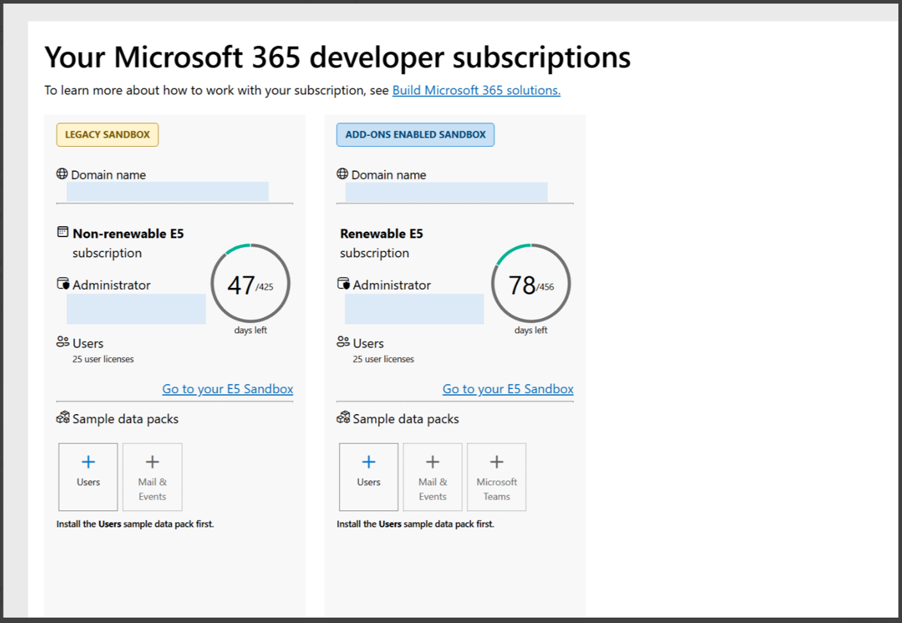

# Retirement of legacy Microsoft 365 developer subscriptions

Microsoft 365 Developer Program is retiring legacy developer subscription (sandbox). If your subscription is labeled **Legacy sandbox** on your [Developer Program dashboard](https://developer.microsoft.com/microsoft-365/profile), this article explains what's changing, when it happens, and what you can do.

## About this change

### Which subscriptions are affected?

Your subscription is affected if it's labeled **Legacy sandbox** on your Developer Program dashboard. Instant sandboxes with add-on purchases enabled aren't affected. Please note that this change doesn't affect your Developer Program membership.

### I have a Visual Studio subscription. Why is my subscription being retired?

Legacy subscriptions are being retired for all members, including Visual Studio Professional and Enterprise subscribers. If you're still eligible, you can set up a new subscription, which supports add-on purchases. For details, see [Join the Microsoft 365 Developer Program with a Visual Studio Professional or Enterprise subscription \| Microsoft Learn](join-with-visual-studio.md)

### What happens to my legacy developer subscription?

- **If you are eligible for a new subscription** \[See eligibility here [Welcome to the Microsoft 365 Developer Program \| Microsoft Learn](microsoft-365-developer-program.md)\], your legacy subscription receives one final 60-day renewal. When it’s applied, we’ll email you, and your Developer Program dashboard will show the expiry date. Before the expiration date, create a new developer subscription from your dashboard and move anything you want to keep.

- **If you’re no longer eligible:** your legacy subscription won’t be renewed. It expires at the end of its current term

- After expiry, the subscription goes into read only state for 30 days and is permanently deleted 30 days later.

| When | What happens | What you should do |
|----|----|----|
| Day 0 (You're notified) | Your subscription gets its final 60-day renewal. | Check the expiry date on your Developer Program dashboard. |
| Days 0–60 | Your legacy subscription stays active. | Move your work to your new subscription (if eligible) |
| Day 60 | Your legacy subscription expires. | Finish copying out anything you want to keep. |
| Days 60–90 | Your legacy subscription is inactive and goes into read only state. Only the admin can sign in for data recovery. | Back up anything you still need. |
| Day 90 | Your legacy subscription and all its data are permanently deleted. | Nothing can be recovered after this date. |

### Can I extend, convert, or transfer my legacy subscription?

No, a legacy subscription cannot be renewed again, cannot be converted to a subscription with add-on purchases enabled, and its benefits can't be transferred to another subscription. To keep developing, you’ll have the option to set up a new tenant within the 60-day window, if you’re eligible. For eligibility details, see [Microsoft 365 Developer Program FAQ \| Microsoft Learn](microsoft-365-developer-program-faq.yml#who-qualifies-for-a-microsoft-365-e5-developer-subscription-).

## Set up a new subscription

### Am I eligible for a new subscription?

For the full eligibility details, see [Microsoft 365 Developer Program FAQ \| Microsoft Learn](microsoft-365-developer-program-faq.yml#who-qualifies-for-a-microsoft-365-e5-developer-subscription-).

### How do I set up a new subscription?

If you're eligible, you can set up a free Microsoft 365 E5 developer subscription with 25 user licenses, It's provisioned as an instant sandbox with sample data, and it supports add-on purchases such as Microsoft 365 Copilot licenses. For detailed steps, see [Set up a Microsoft 365 developer sandbox subscription \| Microsoft Learn](microsoft-365-developer-program-get-started.md).

### Why do I need a billing account to set up the new subscription?

A billing account is required to set up a new sandbox. It's used to verify your identity and to enable optional purchases. You won't be charged for the sandbox itself. For requirements, see [Configure billing details](microsoft-365-developer-program-get-started.md#step-2-configure-billing-details).

### Can I set up the new subscription before my legacy one expires?

Yes. If you're eligible, you will have the option to create a new subscription within that 60 days window. Setting up early gives you the most time to move your work.

### Can I keep using my legacy subscription while I set up the new one?

Yes. Your legacy subscription remains active until its expiry date, which is shown on your Developer Program dashboard. You can set up the new subscription and move your work across before then. Nothing transfers automatically: your new subscription has a new domain name and doesn't include any data or settings from your legacy subscription.

## Move your work

### What should I move before my subscription is deleted?

Anything that exists only in your legacy subscription is deleted with it, and you're responsible for copying out anything you want to keep. Your new subscription is a separate tenant with a new domain name and tenant ID, so plan to re-create or redeploy your work rather than copy it across directly. Check these items:

- **Apps and registrations:** Microsoft Entra app registrations (client IDs, secrets, certificates, redirect URIs, and API permissions), Teams app packages, SharePoint Framework (SPFx) solutions, Office add-ins, Copilot agents, and bot registrations. Register and deploy them again in your new subscription, then grant admin consent.

- **Code and configuration:** source code, scripts, environment settings, and CI/CD pipelines that reference your old tenant ID, domain name, app IDs, or user accounts.

- **Power Platform solutions:** [export your Power Apps, Power Automate flows, and Dataverse customizations as solutions](/power-apps/maker/data-platform/export-solutions), then import them and re-create connections in your new subscription.

- **Content:** files, SharePoint sites and lists, OneDrive content, and Teams channels and files that you need for testing.

- **Mail and calendars:** any test mailboxes or calendar data you rely on.

- **Users, groups, and settings:** test users, groups, licenses, and admin or security settings that your solutions depend on. Your new subscription includes its own sample users and data.

For guidance, see how to [migrate mailboxes across tenants](/microsoft-365/migration/cross-tenant-mailbox-migration) and how to [migrate content to Microsoft 365](/sharepointmigration/migrate-to-sharepoint-online). Most developers find it simpler to export what they need and redeploy it, because cross-tenant migration tools can require additional licenses.

### What if I'm not eligible for a new subscription?

Your legacy subscription is retired on the same schedule, and there's no replacement subscription. Copy out anything you want to keep before your deletion date. To keep developing, you can get a sandbox through a Visual Studio Professional or Enterprise subscription or an eligible partner program or use a Microsoft 365 trial or paid plan.

For eligibility details, see [Microsoft 365 Developer Program FAQ \| Microsoft Learn](microsoft-365-developer-program-faq.yml#who-qualifies-for-a-microsoft-365-e5-developer-subscription-).

## After deletion

### Can a deleted subscription be restored?

No. Deletion is permanent and can't be reversed by you or by Microsoft. If you're eligible, you can set up a new subscription, but it won't include any of your previous data.

### Where can I get help?

If you have trouble setting up a new subscription, see the troubleshooting section of [Set up a Microsoft 365 developer sandbox subscription \| Microsoft Learn](microsoft-365-developer-program-get-started.md)

### Which terms apply?

Your use of the program, including your developer subscription, is governed by [Terms and conditions \| Microsoft Learn](terms-and-conditions.md).

## Related content

- [Microsoft 365 Developer Program FAQ \| Microsoft Learn](microsoft-365-developer-program-faq.yml)

- [Set up a Microsoft 365 developer sandbox subscription \| Microsoft Learn](microsoft-365-developer-program-get-started.md)

- [Terms and conditions \| Microsoft Learn](terms-and-conditions.md)
